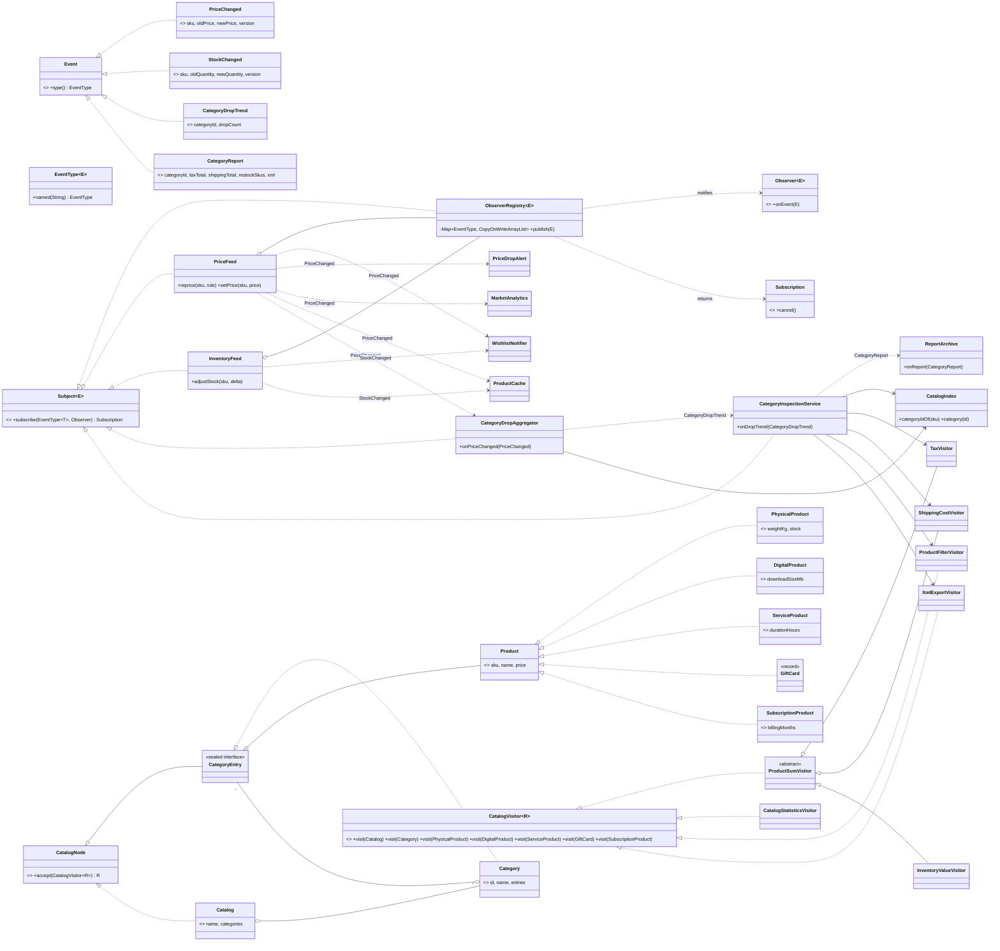

# Assignment 6 — Observer & Visitor: Online Marketplace (Variant 4)

A small Java 17 system where live **price and stock changes** are pushed to subscribers
(Observer), and new operations — **tax, shipping cost, statistics, filtering, XML export** —
run over a stable **product catalog tree** (Visitor). A trend of price drops in a category
triggers an inspection of that category subtree only, and the result returns to the system
as a report event.

No libraries besides JUnit 5. No `java.util.Observable`, no event bus.

## Build and run

```bash
mvn test                                    # 27 JUnit tests
mvn -q compile
java -cp target/classes com.marketplace.App 4 1000   # <producer threads> <events per producer>
```

## Structure

| Package | Contents |
|---|---|
| `observer` | `Event`, `EventType<E>`, `Observer<E>`, `Subject<E>`, `Subscription`, `ObserverRegistry<E>` |
| `event` | Immutable records: `PriceChanged`, `StockChanged`, `CategoryDropTrend`, `CategoryReport` |
| `feed` | Subjects: `PriceFeed`, `InventoryFeed` |
| `listener` | `WishlistNotifier`, `PriceDropAlert`, `MarketAnalytics`, `ProductCache`, `CategoryDropAggregator` (listener **and** subject), `ReportArchive` |
| `catalog` | Composite: `Catalog`, `Category` (containers); `PhysicalProduct`, `DigitalProduct`, `ServiceProduct`, `GiftCard`, `SubscriptionProduct` (leaves); `CatalogVisitor<R>` |
| `visitor` | `TaxVisitor`, `ShippingCostVisitor`, `InventoryValueVisitor` (numeric, via `ProductSumVisitor`), `CatalogStatisticsVisitor` (accumulating state), `ProductFilterVisitor` (filter), `XmlExportVisitor` (export), `CatalogIndex` |
| `integration` | `CategoryInspectionService` — the Observer → Visitor → Observer link |
| `concurrency` | `ProducerPool` (ExecutorService wrapper, graceful shutdown), `MarketTrafficGenerator` (producer task) |
| root | `App` (composition root), `AppConfig`, `SampleCatalog` |

## UML class diagram



## Design decisions

### Observer

* **Generic, type-safe subscription.** `EventType<E>` is a key that carries the event class as a
  type parameter, declared once per event (`PriceChanged.TYPE`). `subscribe(PriceChanged.TYPE, o)`
  only compiles when `o` accepts `PriceChanged` (or a supertype, e.g. `MarketAnalytics::onEvent(Event)`).
  The one unchecked cast lives in `ObserverRegistry.deliver` and is safe because a registration is
  only stored under its own type.
* **Composition, not inheritance.** Every subject (`PriceFeed`, `InventoryFeed`,
  `CategoryDropAggregator`, `CategoryInspectionService`) owns an injected `ObserverRegistry` and
  delegates `subscribe` to it, so there is one registry implementation and no base class.
* **Push model.** Each event carries everything listeners need (old/new value, per-SKU version).
  Justification: delivery happens on many producer threads; with *pull*, a listener would read the
  subject's state *after* the event, when another thread may already have changed it, so it could
  never tell which change it is reacting to. Immutable pushed events are a consistent snapshot and
  keep listeners decoupled from the subject's API. Cost: a listener that needs more data than the
  event carries cannot ask for it — we accepted that, events are small.
* **Join/leave at runtime.** `subscribe` returns a `Subscription`; `cancel()` is idempotent. Because
  each type's list is a `CopyOnWriteArrayList`, publishing iterates over a snapshot: an observer that
  cancels itself, or subscribes another observer, inside its handler causes no
  `ConcurrentModificationException`, and the change applies from the next event
  (tests `observerCanUnsubscribeFromInsideItsOwnHandler`, `observerSubscribedFromAHandlerStartsWithTheNextEvent`).
* **Chain of observers.** `CategoryDropAggregator` listens to `PriceChanged` and republishes
  aggregated `CategoryDropTrend` events (one per full window of N drops in a category), which
  `CategoryInspectionService` listens to; it in turn publishes `CategoryReport`.

### Visitor

* **Tree.** `Catalog → Category → Category → product` (3+ levels, 2 container types, 5 leaf types).
  Elements are records: data plus `accept`, nothing else. `sealed` interfaces make the hierarchy
  closed, and `CategoryEntry` makes it impossible to put a `Catalog` inside a category.
* **Double dispatch.** `node.accept(visitor)` dispatches on the node's runtime class (virtual call);
  inside `PhysicalProduct.accept`, `visitor.visit(this)` has static type `PhysicalProduct`, so the
  compiler picks the `visit(PhysicalProduct)` overload — the second dispatch is on the visitor's
  runtime class. A client cannot write `visitor.visit(node)` for a `CatalogNode node`: overloads
  are resolved at compile time and there is no `visit(CatalogNode)`.
* **The visitor does the traversal.** Container `accept` only calls `visit(this)`; the visitor
  decides whether and how to descend. Reasons: the result type `R` must be *combined* from
  children differently per operation (sum, list concatenation, XML wrapping with open/close tags
  around children, depth counters), and the integration needs to run a visitor on any subtree.
  The cost — repeated recursion code — is removed with `ProductSumVisitor`, the shared traversal
  for all numeric visitors.
* **Four required kinds:** numeric — `TaxVisitor`, `ShippingCostVisitor` (`InventoryValueVisitor`
  added in trade-off commit 1); accumulating state — `CatalogStatisticsVisitor` (counts per type,
  current/max depth, stock, most expensive product; single-use, created by `collect`); filter —
  `ProductFilterVisitor(Predicate)` returns `List<Product>`; export — `XmlExportVisitor`, which
  returns a fragment per node and indents children inside their parent tag, so nesting is correct
  by construction; attribute values are escaped.

### Integration

`PriceFeed` → `CategoryDropAggregator` (Observer, aggregation) → `CategoryDropTrend` →
`CategoryInspectionService` looks up **only that category** via `CatalogIndex` and runs
`TaxVisitor`, `ShippingCostVisitor`, a restock `ProductFilterVisitor` and `XmlExportVisitor`
on it (Visitor) → publishes a `CategoryReport` event → `ReportArchive`, `MarketAnalytics`
(Observer). Test: `CategoryInspectionTest`.

The catalog tree is immutable and holds the *opening* stock, so the restock filter's predicate
reads the live level from `InventoryFeed.currentStock` instead: the report reflects the stock
changes that happened since start-up, while element classes stay plain data.

### Concurrency (Clean Code ch. 13)

* `ProducerPool` runs `MarketTrafficGenerator` tasks on an injected `ExecutorService`
  (`Executors.newFixedThreadPool(config.producerThreads())`, configurable via CLI).
* **No global lock.** The registry is a `ConcurrentHashMap` of per-type copy-on-write lists:
  publishers of different types never contend; subscribing touches only one type's list.
* **Shared state** is in concurrent structures with atomic per-key updates:
  feeds use `computeIfPresent` (update + version in one atomic step, publish *outside* the map
  lock); `CategoryDropAggregator` uses `merge` so each count is produced by exactly one thread;
  `WishlistNotifier` relies on `Set.remove` returning `true` for exactly one thread, so a wish
  fires exactly once; `MarketAnalytics` uses `LongAdder`; `ProductCache` keeps the higher per-SKU
  version, so out-of-order delivery converges to the feed's value.
* **Graceful shutdown, no lost events.** Delivery is synchronous on the producer thread, so there
  is no internal queue that could be dropped. `runAll` waits for every task's `Future`;
  `close()` calls `shutdown()`, `awaitTermination(timeout)` and only then `shutdownNow()`.
  `StressTest` checks 4 threads × 1,000 events = exactly 4,000 deliveries and that the executor
  is terminated.
* **Failure isolation.** A listener that throws does not stop delivery: `publish` notifies every
  observer, then rethrows the first failure with later ones attached as suppressed, so the
  producer still sees the error instead of it being swallowed.
* Known limitation: observers run on the publisher's thread, so a slow listener slows its producer.

### Clean Code (ch. 11–12)

* `App.main` is the **single composition root**; every other class gets collaborators through
  its constructor. No setters, no service locator, no lazy initialization (`CatalogIndex` is
  built eagerly once).
* Every interface has a reason: `Observer`/`Subject`/`Subscription` are the pattern contracts,
  `CatalogNode`/`CategoryEntry`/`Product` constrain the tree, `CatalogVisitor` is the pattern.
  Listeners are plain classes subscribed via method references — they need no common interface.

## Trade-off proof

| Commit | Change | Files touched |
|---|---|---|
| `Trade-off 1: add InventoryValueVisitor without touching any element class` | new operation | `visitor/InventoryValueVisitor.java` (new), `VisitorTest.java` — **2 files, 0 element classes** |
| `Trade-off 2: add SubscriptionProduct element type to every visitor` | new element type | `catalog/SubscriptionProduct.java` (new), `catalog/Product.java` (permits), `catalog/CatalogVisitor.java` (new `visit`), `visitor/TaxVisitor.java`, `visitor/ShippingCostVisitor.java`, `visitor/InventoryValueVisitor.java`, `visitor/CatalogStatisticsVisitor.java`, `visitor/ProductFilterVisitor.java`, `visitor/XmlExportVisitor.java`, `visitor/CatalogIndex.java`, `SampleCatalog.java`, `VisitorTest.java` — **12 files** |

See them with `git show --stat <hash>`.

**Cost.** A new operation is one new class: the open/closed principle holds for operations.
A new element type changes the visitor interface and therefore *every* visitor (7 implementations
here) — the cost grows linearly with the number of visitors. The upside is that the compiler
(abstract method + `sealed` permits) lists every place to update, so nothing is silently missed.

**When to reject Visitor:** when element types change more often than operations (e.g. a
marketplace where sellers add new product kinds every sprint), when visitors are written by
third parties who cannot be recompiled, or when most visitors would treat the new type the same
way — then polymorphic methods on the elements, or pattern matching over a sealed hierarchy, are cheaper.

## Tests (27)

| Class | What it checks |
|---|---|
| `ObserverRegistryTest` (6) | per-type delivery, cancel, unsubscribe and subscribe inside a handler, duplicate subscription, concurrent subscribe/cancel while 3 threads publish |
| `FeedAndListenerTest` (7) | old/new price + versions, unknown SKU, stock floor at zero, wishlist once-only, alert threshold, cache ordering, aggregator windows |
| `VisitorTest` (9) | tax 194.50, shipping 16.50, inventory value 10,000.00, statistics, filter, exact XML with escaping, double dispatch through `CatalogNode`, subscription element, index |
| `CategoryInspectionTest` (2) | report computed on the subtree only; full chain feed → aggregator → inspection → archive |
| `StressTest` (3) | 4 × 1,000 events = exactly 4,000, executor terminated, cache converges; wish fulfilled exactly once under concurrency; failing producer reported and pool still shuts down |
